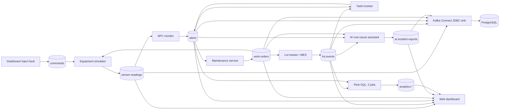

# AIDP-FAB: event-driven semiconductor fab on Confluent Kafka

A runnable demo of **event-driven architecture with Kafka** in a semiconductor fab. Tools and
wafer lots are simulated; everything else is real: Kafka producers and consumers, topics, keys,
partitions, consumer groups, Kafka Connect, Flink SQL and an AI assistant.

**The story:** an etch chamber starts drifting → SPC catches it on the live sensor stream → a
maintenance work order opens automatically → the tool goes down and lots are routed around it →
lots that ran on the bad tool fail inspection and go on HOLD → an **AI assistant writes the
incident report** → **Flink SQL** shows yield dropping live → everything lands in **PostgreSQL**.
No service calls another one; they only publish and react to events.

---

## Step-by-step: first-time setup (macOS)

You need Docker Desktop, and Python with `confluent-kafka` (Anaconda `base` works).
Docker Desktop needs at least **6 GB of memory**: Docker Desktop → Settings → Resources.

```bash
cd ~/Downloads/fab-kafka-demo
conda activate base
pip install -r requirements.txt
```

**1. Remove the old single Kafka container** (only if you created one earlier with `docker run`).
The compose file creates a new one, and this deletes the old demo topics.
```bash
docker rm -f kafka
```

**2. Download the two connector plugins** (JDBC connector for PostgreSQL, Kafka connector for Flink):
```bash
python setup_demo.py download
```

**3. Start the infrastructure** (Kafka, Kafka Connect, PostgreSQL, Flink, Kafbat UI). The first run downloads about 3 GB of images.
```bash
docker compose up -d
docker compose ps
```
All six containers should show `running`.

**4. Wire everything up** (topics, PostgreSQL tables, the PostgreSQL sink connector, the 3 Flink SQL jobs):
```bash
python setup_demo.py init
```
It waits for each service and ends with a summary; every line should say `[ok]`. It's safe to run again.

**5. (Optional) Let an AI model write the incident reports.** Without this, a built-in template writes them.
For IBM watsonx.ai:
```bash
cp ai.env.example ai.env
open -e ai.env
source ai.env
python rca_assistant.py --test
```
Fill in your Cloud Pak for Data URL, project ID, username and API key in `ai.env`, then save it.
`--test` sends sample facts to the model and prints the report it writes. Run `source ai.env` in every new
terminal before `run_demo.py`. Claude (`ANTHROPIC_API_KEY`) and a local Ollama model (`OLLAMA_MODEL`) also work.

**6. Start the demo:**
```bash
python run_demo.py --no-random-faults
```
The dashboard opens at **http://localhost:8080**. Press Ctrl+C to stop the Python services.

| URL | What |
|---|---|
| http://localhost:8080 | AIDP-FAB dashboard |
| http://localhost:8090 | Kafbat UI: topics, live messages, consumer groups and lag, connectors |
| http://localhost:8081 | Flink UI: the 3 running SQL jobs |
| `localhost:5433` | PostgreSQL (database, user and password all `fab`) |

## Every day after that

```bash
cd ~/Downloads/fab-kafka-demo
conda activate base
docker compose start
python setup_demo.py init
python run_demo.py --no-random-faults
```
`init` takes a few seconds on later runs. It resubmits the Flink jobs, which Flink forgets when its
container restarts; topics, the connector and database rows are kept. To stop: Ctrl+C, then `docker compose stop`.

---

## What's on the dashboard

| Panel | What it shows | Kafka source |
|---|---|---|
| KPIs | events/s, tools available, open work orders, lots on hold, line yield | all topics |
| Process equipment | 6 tools with live status and an **Inject fault** button | sensor-readings |
| SPC control chart | the selected tool's 4 sensors against ±3σ limits | sensor-readings |
| Live alerts | SPC and yield alerts, each with topic, partition and offset | alerts |
| **AI root-cause assistant** | the latest incident report and which AI wrote it | ai.incident-reports |
| **Services & consumer lag** | each service, its consumer lag, and **Stop / Start** buttons | consumer group offsets |
| **Flink SQL analytics** | line yield, lots per tool and alerts per tool over the last minute | analytics.* (written by Flink) |
| Kafka event flow | producers → topics → consumers with moving message dots | all topics |
| Wafer lots, work orders | lot route progress, yield, HOLD; repairs and technicians | lot.events, work-orders |

## The three advanced features

### 1. Kill a service: Kafka's resilience, live
Each Python service is a separate process with its own consumer group. Click **Stop** on
`maintenance-service`, then break a tool: alerts still flow, nothing crashes, and its **lag**
(the events waiting for it in Kafka) climbs. Click **Start**: it resumes from its last committed
offset, works through the backlog and opens the missed work order. Kafbat UI (port 8090) shows the
same consumer group lag from Kafka's side.

### 2. AI root-cause assistant (`rca_assistant.py`)
One more consumer. When lots go on HOLD, it waits until the burst of holds is over (about 15 s of quiet).
It then gathers the facts from the streams: SPC warning and critical times, the work order and technician,
held lots and yields, and a comparison with the other tool of the same step (for example "ETCH-01:
0 of 5 lots failed, ETCH-02: 6 of 9 failed"). It asks an LLM for a short incident report and
publishes it to `fab.ai.incident-reports`. The report shows on the dashboard and is stored in PostgreSQL.

| Writer | How to enable |
|---|---|
| IBM watsonx.ai | `WATSONX_URL`, `WATSONX_PROJECT_ID`, `WATSONX_USERNAME`, `WATSONX_API_KEY` (see `ai.env.example`); model `WATSONX_MODEL` (default `openai/gpt-oss-120b`). The bearer token is fetched from `/icp4d-api/v1/authorize` and refreshed automatically. |
| Claude | `export ANTHROPIC_API_KEY=...`; optional `AI_MODEL` (default `claude-haiku-5-5`) |
| Ollama (local) | `export OLLAMA_MODEL=llama3.2`; optional `OLLAMA_URL` |
| Built-in template | default; also used automatically if the AI call fails |

### 3. Flink SQL live analytics (`flink/aidp-fab.sql`)
Three continuous SQL queries run in Flink, each reading Kafka and writing results back to a new topic:

| Job | Query | Output topic |
|---|---|---|
| Line yield | `AVG(yield_pct)` over a 1-minute window, updated every 10 s | `fab.analytics.line-yield` |
| Lots per tool | `COUNT(*) GROUP BY tool_id`; drops to zero for a tool that is down | `fab.analytics.tool-throughput` |
| Alerts per tool | `COUNT(*)` of alerts `GROUP BY tool_id` | `fab.analytics.alert-counts` |

They use sliding (HOP) windows on processing time, so results keep arriving even when a topic is
quiet. Edit the SQL and run `python setup_demo.py flink-restart` to resubmit.

## 12-minute demo script

1. **Healthy fab (1 min).** All tools UP, about 8 events/s, Flink line yield near 100%. Point at the event-flow diagram.
2. **Break a tool (2 min).** Click **Inject fault** on ETCH-02. Narrate: WARNING (~20 s) → CRITICAL (~35 s)
   → work order → ETCH-02 DOWN → lots rerouted to ETCH-01 (see Flink *lots per tool*) → lots on HOLD → tool repaired.
3. **AI report (1 min).** About 15 s after the last hold, the incident report appears. Read out the root cause and the ETCH-01 vs ETCH-02 comparison.
4. **Flink (1 min).** Show the yield bars dropping and recovering, and the jobs in the Flink UI (8081).
5. **Resilience (3 min).** Stop `maintenance-service`, inject a fault on CVD-01, watch its lag grow while the tool stays CRITICAL with no repair. Start it and watch it catch up and open the work order.
6. **Under the hood (2 min).** Kafbat UI (8090): topics, live messages, consumer groups and lag, the connector.
7. **History (1 min).** Query PostgreSQL:
   ```bash
   docker exec -it postgres psql -U fab -d fab -c "SELECT incident_id, suspect_tool, lots_held, generated_by FROM v_ai_incident_reports;"
   ```
8. **Traceability (1 min).** `python lot_genealogy.py`, then `python lot_genealogy.py LOT-xxxxxx` for a held lot, replayed from Kafka offset 0.

Reset between rehearsals: Ctrl+C, `python create_topics.py --reset`, `python setup_demo.py init`, then `python run_demo.py --no-random-faults`.

---

## Architecture



| Topic | Key | Partitions | Written by |
|---|---|---|---|
| `fab.equipment.sensor-readings` | tool_id | 6 | equipment simulator |
| `fab.equipment.commands` | tool_id | 1 | dashboard / inject_fault.py |
| `fab.lot.events` | lot_id | 3 | lot tracker (kept forever) |
| `fab.alerts` | tool_id / lot_id | 3 | SPC monitor, yield monitor |
| `fab.maintenance.work-orders` | tool_id | 3 | maintenance service |
| `fab.ai.incident-reports` | tool_id | 1 | AI root-cause assistant (kept forever) |
| `fab.analytics.*` (3 topics) | none | 1 | Flink SQL jobs |

### Files

| File | Role |
|---|---|
| `equipment_simulator.py`, `lot_tracker.py` | simulated tools and MES (producers) |
| `spc_monitor.py`, `yield_monitor.py`, `maintenance_service.py` | the event-driven services |
| `rca_assistant.py` | AI root-cause assistant |
| `web_dashboard.py`, `web/index.html` | browser dashboard (also the lag monitor and Stop/Start API) |
| `services.py`, `run_demo.py` | process manager and one-command launcher |
| `setup_demo.py` | downloads plugins; creates topics, schema, connector and Flink jobs; status |
| `docker-compose.yml` | Kafka, Kafka Connect, PostgreSQL, Flink (jobmanager and taskmanager), Kafbat UI |
| `connect/postgres-sink.json`, `connect/postgres-init.sql` | sink connector config; tables and `v_*` views |
| `flink/aidp-fab.sql` | the Flink SQL jobs |
| `inject_fault.py`, `lot_genealogy.py`, `dashboard.py`, `create_topics.py` | CLI tools and the terminal dashboard |

## PostgreSQL (Kafka Connect JDBC sink)

Confluent's JDBC sink connector copies 6 topics into tables (`sensor_readings`, `lot_events`, `alerts`,
`work_orders`, `equipment_commands`, `ai_incident_reports`). Each row holds the full event as JSONB, keyed
by topic, partition and offset, so replays never duplicate rows. Views make it readable:

```sql
SELECT * FROM v_alerts ORDER BY event_time DESC LIMIT 10;
SELECT * FROM v_work_orders ORDER BY opened_at DESC;
SELECT round(avg(yield_pct), 1) AS avg_yield, count(*) FILTER (WHERE yield_pct < 90) AS lots_held FROM v_lot_yield;
SELECT * FROM v_lot_history WHERE lot_id = 'LOT-123456' ORDER BY event_time;
SELECT incident_id, suspect_tool, report FROM v_ai_incident_reports ORDER BY created_at DESC;
```
Open a shell with `docker exec -it postgres psql -U fab -d fab`, or use pgAdmin or DBeaver on `localhost:5433`.

## Troubleshooting

| Symptom | Fix |
|---|---|
| `setup_demo.py init` shows `[FAIL]` | Read the message; fix it, then run `init` again (it is safe to repeat). `python setup_demo.py status` shows everything. |
| Connector FAILED with `NoSuchMethodError ... mkSet` | Old JDBC connector. Run `python setup_demo.py download` (gets 10.9.9), `docker compose restart connect`, then `init`. |
| Connector FAILED | `docker compose logs connect`. The plugin missing? Run `python setup_demo.py download`, then `docker compose restart connect`. |
| Flink panel says "No Flink results yet" | Run `python setup_demo.py status`. If no jobs are listed, run `python setup_demo.py flink-restart`. Check http://localhost:8081. |
| Containers keep restarting or exit | Give Docker Desktop more memory (6 GB or more). `docker compose ps` and `docker compose logs <name>` show details. |
| Port already in use (5433, 8080, 8081, 8090) | Change the left number of the `ports:` entry in `docker-compose.yml`, or `--port` for run_demo. |
| AI report says `template (AI call failed)` | Run `python rca_assistant.py --test` to see the exact error; also see `logs/rca_assistant.log`. |
| watsonx: `CERTIFICATE_VERIFY_FAILED` | The cluster uses a self-signed certificate: set `WATSONX_VERIFY_SSL="false"` in `ai.env`. |
| watsonx: timeout or name not resolved | The Cloud Pak for Data cluster is on the IBM network: connect to the VPN first. |
| watsonx: HTTP 401 | Wrong username or API key (generate the key in Cloud Pak for Data: Profile and settings → API key). |
| `No module named confluent_kafka` | Run `conda activate base` in that terminal. |

## Handy Kafka CLI commands

Kafka runs in Docker, so prefix commands with `docker exec kafka`:
```bash
docker exec kafka kafka-topics --bootstrap-server localhost:9092 --list
docker exec -it kafka kafka-console-consumer --bootstrap-server localhost:9092 --topic fab.ai.incident-reports --from-beginning
docker exec kafka kafka-consumer-groups --bootstrap-server localhost:9092 --list
docker exec kafka kafka-consumer-groups --bootstrap-server localhost:9092 --describe --group maintenance-service
```

## Kafka concepts this demo shows

| Concept | Where you see it |
|---|---|
| Topics per business event type | 9 `fab.*` topics |
| Keys → partition → per-key ordering | `tool_id` for readings, `lot_id` for lot events |
| Consumer groups, fan-out | every service, Flink, Connect and the dashboard read the same topics independently |
| Consumer lag, offsets, resilience | Services panel, Stop/Start, Kafbat UI |
| Event choreography | alert → work order → tool down → lots rerouted → repaired, with no orchestrator |
| Stream processing | Flink SQL sliding-window aggregations writing new topics |
| Stream join / enrichment | yield monitor and AI assistant combine lot events, alerts and work orders |
| Kafka Connect | JDBC sink to PostgreSQL with single message transforms |
| Retention and replay | `lot_genealogy.py`; lot events and AI reports kept forever |
