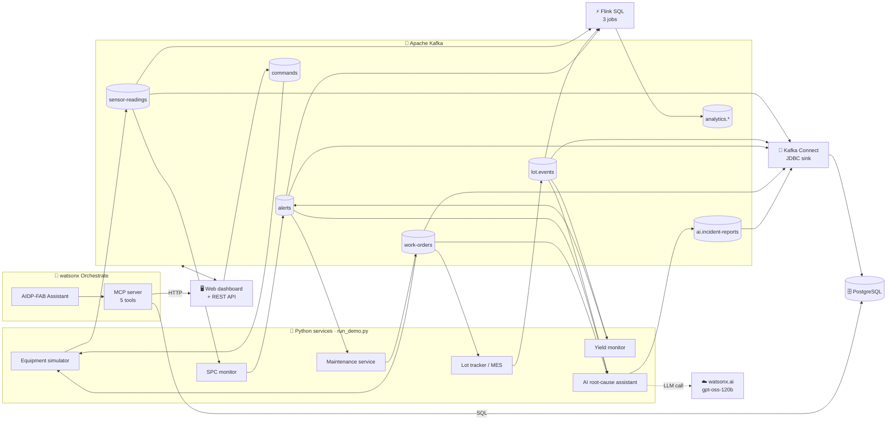

# Kafka-Agentic-AI-demonstartion-in-Intelligent-Fab-Semiconductors

<div align="center">

# 🏭 AIDP-FAB

### A semiconductor fab that runs on events: Kafka streams, live analytics, an AI root-cause assistant and an agent you can just ask


**No services call each other. They only publish events and react to them.**

[What it does](#-what-it-does-in-30-seconds) ·
[Architecture](#-architecture) ·
[Quick start](#-quick-start) ·
[Demo script](#-10-minute-demo) ·
[AI agent](#-talk-to-the-fab-watsonx-orchestrate-agent) ·
[Troubleshooting](#-troubleshooting)

</div>

---

## 💡 What it does, in 30 seconds

A chip fab has dozens of machines, thousands of wafers and many teams that all need to know when something goes wrong, **right now**. AIDP-FAB shows how Apache Kafka solves that with an **event-driven architecture**.

The machines and wafer lots are simulated. Everything else is real: Kafka producers and consumers, topics, partitions, consumer groups, Kafka Connect, Flink SQL, an LLM and an AI agent.

**Here is what happens when one machine starts to fail:**

```
 🔧 Etch chamber starts drifting
   ↓  SPC monitor catches it on the live sensor stream (WARNING ~20 s, CRITICAL ~35 s)
 🛠️  A maintenance work order opens automatically and a technician is assigned
   ↓  The tool goes DOWN, lots are routed to its sister tool
 📉 Lots that ran on the bad tool fail inspection and go on HOLD
   ↓
 🤖 An AI assistant (watsonx.ai) writes the incident report and names the root cause
 📊 Flink SQL shows the line yield dropping and recovering, live
 🗄️  Every event lands in PostgreSQL through Kafka Connect
 💬 An engineer asks the agent "Why was the last lot held?" and gets the answer
```

Each step is a separate service reacting to a Kafka event. Stop one and the others keep working; start it again and it catches up from where it left off.

---

## ✨ Features

| | Feature | What you'll see |
|---|---|---|
| 📡 | **Live event streams** | 6 process tools (litho, etch, CVD, CMP) streaming sensor data across 9 Kafka topics |
| 📈 | **Statistical process control** | Western Electric rules on every sensor: 4 of 5 points beyond 1σ is a WARNING, beyond 3σ is CRITICAL |
| 🖥️ | **Browser dashboard** | Tools, SPC chart, alerts, lots, work orders and an animated event-flow diagram, updating live |
| 💥 | **Kill-a-service button** | Stop any consumer, watch its **lag** grow, start it again and watch it catch up with nothing lost |
| 🤖 | **AI root-cause assistant** | Turns alerts, holds and work orders into an incident report using IBM watsonx.ai (gpt-oss-120b) |
| ⚡ | **Flink SQL analytics** | Three continuous queries over 1-minute sliding windows: line yield, lots per tool and alerts per tool |
| 🗄️ | **Kafka Connect → PostgreSQL** | Confluent JDBC sink copies the topics into tables, with readable `v_*` views on top |
| 🔍 | **Kafbat UI** | Browse topics, live messages, consumer groups and connectors |
| 💬 | **watsonx Orchestrate agent** | Ask questions in plain English; 5 MCP tools fetch the answers from the dashboard and PostgreSQL |

---

## 🧭 Architecture



**How to read it:** producers on the left write events, Kafka keeps them, and every consumer reads the same events on its own. Flink, Kafka Connect and the dashboard never wait for each other. The agent sits at the very end: it doesn't touch Kafka at all, it asks the dashboard API and the database.

### Kafka topics

| Topic | Key | Partitions | Written by |
|---|---|---|---|
| `fab.equipment.sensor-readings` | tool_id | 6 | equipment simulator |
| `fab.equipment.commands` | tool_id | 1 | dashboard (Inject fault) |
| `fab.lot.events` | lot_id | 3 | lot tracker (kept forever) |
| `fab.alerts` | tool_id / lot_id | 3 | SPC monitor, yield monitor |
| `fab.maintenance.work-orders` | tool_id | 3 | maintenance service |
| `fab.ai.incident-reports` | tool_id | 1 | AI root-cause assistant (kept forever) |
| `fab.analytics.line-yield` / `tool-throughput` / `alert-counts` | none | 1 | Flink SQL jobs |

---

## 🚀 Quick start

### What you need

- **Docker Desktop** with at least **6 GB of memory** (Settings → Resources)
- **Python 3.10+** (Anaconda `base` works)
- About 3 GB of free disk for the images

### 1. Clone and install

```bash
git clone https://github.com/<your-username>/aidp-fab.git
cd aidp-fab
pip install -r requirements.txt
```

### 2. Download the connector plugins

The JDBC connector for PostgreSQL and the Kafka connector for Flink. They are not stored in the repo.

```bash
python setup_demo.py download
```

### 3. Start the infrastructure

Kafka, Kafka Connect, PostgreSQL, Flink and Kafbat UI:

```bash
docker compose up -d
docker compose ps
```

All six containers should show `running`.

### 4. Wire everything up

Creates the topics, PostgreSQL tables and views, the sink connector and the three Flink jobs:

```bash
python setup_demo.py init
```

Every line should end in `[ok]`. It's safe to run again.

### 5. Run the fab 🎉

```bash
python run_demo.py --no-random-faults
```

The dashboard opens in your browser. Click **Inject fault** on any tool and watch the chain reaction.

| Open | What |
|---|---|
| http://localhost:8080 | 🖥️ AIDP-FAB dashboard |
| http://localhost:8090 | 🔍 Kafbat UI (topics, messages, consumer lag) |
| http://localhost:8081 | ⚡ Flink UI (the 3 SQL jobs) |
| `localhost:5433` | 🗄️ PostgreSQL (database, user and password are all `fab`) |

> **Port 8080 already taken?** (watsonx Orchestrate uses it.) Run `python run_demo.py --no-random-faults --port 8085` and open http://localhost:8085.

### Every day after that

```bash
docker compose start
python setup_demo.py init
python run_demo.py --no-random-faults
```

`init` resubmits the Flink jobs, which Flink forgets when it restarts. Topics, the connector and database rows are kept.

To stop: press `Ctrl+C`, then run `docker compose stop`.

---

## 🤖 Let an AI write the incident reports (optional)

Without an AI model, a built-in template writes the reports. To use **IBM watsonx.ai**:

```bash
cp ai.env.example ai.env
```

Fill in your Cloud Pak for Data URL, project ID, username and API key in `ai.env`, then test it:

```bash
python rca_assistant.py --test
```

`rca_assistant.py` loads `ai.env` automatically. It fetches a bearer token from `/icp4d-api/v1/authorize` and refreshes it when it expires.

| AI provider | How to turn it on |
|---|---|
| IBM watsonx.ai | `WATSONX_URL`, `WATSONX_PROJECT_ID`, `WATSONX_USERNAME`, `WATSONX_API_KEY`; model `WATSONX_MODEL` (default `openai/gpt-oss-120b`) |
| Claude | `ANTHROPIC_API_KEY` |
| Ollama (local) | `OLLAMA_MODEL=llama3.2` |
| Built-in template | default, and the fallback whenever an AI call fails |

> 🔒 **`ai.env` holds your API key. Never commit it.** The `.gitignore` in this repo already excludes it.

---

## 🎬 10-minute demo

| # | Time | What to do | What to point at |
|---|---|---|---|
| 1 | 1 min | Show the healthy fab | All tools UP, about 8 events/s, line yield near 100% |
| 2 | 2 min | **Inject fault** on ETCH-02 | WARNING → CRITICAL → work order → tool DOWN → lots rerouted to ETCH-01 → lots on HOLD |
| 3 | 1 min | Wait for the AI report | Root cause and the ETCH-01 vs ETCH-02 comparison |
| 4 | 1 min | Flink panel and Flink UI | Yield bars dropping and recovering |
| 5 | 3 min | **Stop** `maintenance-service`, inject a fault on CVD-01 | Lag climbs and the tool stays CRITICAL. **Start** it: it catches up and opens the missed work order |
| 6 | 1 min | Kafbat UI | Topics, live messages, consumer groups, the connector |
| 7 | 1 min | Ask the agent | "Which lots are on hold and why?" |

Query the history directly:

```bash
docker exec -it postgres psql -U fab -d fab -c "SELECT incident_id, suspect_tool, lots_held FROM v_ai_incident_reports;"
```

Trace one lot by replaying Kafka from offset 0:

```bash
python lot_genealogy.py LOT-xxxxxx
```

---

## 💬 Talk to the fab: watsonx Orchestrate agent

Instead of watching the dashboard all day, ask an agent. `mcp_server/server.py` is a small **FastMCP** server with five tools built only on what the demo already has: the dashboard API and the PostgreSQL views.

| Tool | Reads from | Ask it |
|---|---|---|
| `get_fab_status` | dashboard `GET /api/snapshot` | "How is the fab doing? Is anything down?" |
| `get_held_lots` | PostgreSQL `v_lot_yield` + `v_alerts` | "Which lots are on hold and why?" |
| `get_work_orders` | PostgreSQL `v_work_orders` | "Who repaired ETCH-02 and what did they do?" |
| `get_incident_reports` | PostgreSQL `v_ai_incident_reports` | "What was the root cause of the last incident?" |
| `inject_fault` | dashboard `POST /api/inject` | "Simulate a fault on CMP-01" (the agent confirms first) |

### Set it up (watsonx Orchestrate Developer Edition)

**1. Point the server at your Mac.** Orchestrate runs inside its own VM, so `localhost` won't reach the demo. Find your Mac's IP address:

```bash
ipconfig getifaddr en0
```

Put that IP address into the settings at the top of `mcp_server/server.py`:

```python
DASHBOARD_URL = "http://<your-mac-ip>:8085"
DB = dict(host="<your-mac-ip>", port=5433, dbname="fab", user="fab", password="fab", connect_timeout=5)
```

**2. Start Orchestrate and add the toolkit.** Run these from the repo root, with the demo already running on port 8085:

```bash
orchestrate server start -e .env
orchestrate env activate local

orchestrate toolkits add --kind mcp --name aidp_fab --description "AIDP-FAB fab status, held lots, work orders, AI incident reports" --package-root ./mcp_server --command "python server.py" --tools "*"

orchestrate agents import -f orchestrate/aidp_fab_agent.yaml
orchestrate chat start
```

The chat opens at http://localhost:3000. Pick **AIDP-FAB Assistant** and start asking.

> ⚠️ Always give `--package-root` the small `./mcp_server` folder, never `/` or your home folder. Orchestrate uploads everything inside it.

**After you change `server.py`,** reload the toolkit:

```bash
orchestrate toolkits remove -n aidp_fab
```

Then run the `toolkits add` and `agents import` commands again.

The same server works with any MCP client (Claude Desktop, IDEs): point the client at `python mcp_server/server.py`.

---

## 🗂️ Project structure

```
aidp-fab/
├── run_demo.py              ▶ one command: starts every service and the dashboard
├── setup_demo.py            ⚙ download plugins, create topics, connector, Flink jobs; status
├── docker-compose.yml       🐳 Kafka, Connect, PostgreSQL, Flink, Kafbat UI
│
├── equipment_simulator.py   📡 6 simulated process tools (producer)
├── lot_tracker.py           📦 wafer lots moving through the route (MES)
├── spc_monitor.py           📈 SPC rules → alerts
├── yield_monitor.py         📉 yield check → lot holds
├── maintenance_service.py   🛠️ alerts → work orders and technicians
├── rca_assistant.py         🤖 AI root-cause reports (watsonx.ai, Claude, Ollama or template)
│
├── web_dashboard.py         🖥️ dashboard server, REST API and consumer-lag monitor
├── web/index.html           🖥️ dashboard page
├── services.py              start / stop each service as its own process
├── common.py, equipment.py  shared Kafka helpers, topic names, tool definitions
│
├── connect/                 🔌 JDBC sink config, PostgreSQL tables and v_* views
├── flink/aidp-fab.sql       ⚡ the 3 Flink SQL jobs
├── mcp_server/              💬 FastMCP server with the 5 agent tools
├── orchestrate/             💬 watsonx Orchestrate agent definition
│
├── inject_fault.py          CLI: break a tool from the terminal
├── lot_genealogy.py         CLI: replay a lot's full history from Kafka
├── dashboard.py             terminal version of the dashboard
├── create_topics.py         create or reset the topics
└── ai.env.example           template for your AI credentials (copy to ai.env)
```

---

## 🧠 Kafka concepts you'll see in action

| Concept | Where it shows up |
|---|---|
| **Topics** per business event | 9 `fab.*` topics |
| **Keys → partitions → ordering** | `tool_id` for sensor data, `lot_id` for lot events |
| **Consumer groups and fan-out** | every service, Flink, Connect and the dashboard read the same topics independently |
| **Offsets, lag, resilience** | Services panel with Stop/Start, and Kafbat UI |
| **Event choreography** | alert → work order → tool down → reroute → repair, with no central controller |
| **Stream processing** | Flink SQL sliding-window aggregations writing new topics |
| **Kafka Connect** | JDBC sink to PostgreSQL with single message transforms and upsert |
| **Retention and replay** | `lot_genealogy.py` rebuilds a lot's history from offset 0 |

---

## 🩺 Troubleshooting

| Problem | Fix |
|---|---|
| `connection refused` on 9092 | Kafka isn't running. Run `docker compose up -d`. |
| `No module named confluent_kafka` | Activate the right Python (`conda activate base`), then `pip install -r requirements.txt`. |
| `setup_demo.py init` shows `[FAIL]` | Read the message, fix it and run `init` again. `python setup_demo.py status` shows everything. |
| Connector fails with `NoSuchMethodError ... mkSet` | Old JDBC plugin. Run `python setup_demo.py download`, `docker compose restart connect`, then `init`. |
| Flink panel says "No Flink results yet" | Run `python setup_demo.py flink-restart` and check http://localhost:8081. |
| `address already in use` | Something else has that port. Use `--port 8085` for the dashboard, or change the left number under `ports:` in `docker-compose.yml`. |
| Port 5432 in use when starting Orchestrate | A local PostgreSQL is on 5432. Move it to another port (the demo's own PostgreSQL uses 5433). |
| `docker compose`: unknown flag `-d` | The Compose plugin is missing. Use Docker Desktop's `docker`, or link its `docker-compose` plugin into `~/.docker/cli-plugins`. |
| AI report says `template` | Run `python rca_assistant.py --test` to see the exact error. |
| watsonx `CERTIFICATE_VERIFY_FAILED` | Set `WATSONX_VERIFY_SSL="false"` in `ai.env` (self-signed cluster certificate). |
| Agent says "Cannot reach the fab database" | `server.py` still says `localhost`. Use your Mac's IP and check it with `nc -vz <ip> 5433` and `nc -vz <ip> 8085`. |

---

## 🧰 Tech stack

**Streaming:** Confluent Kafka 8.3 (KRaft) · Kafka Connect with the Confluent JDBC sink 10.9.9 · Apache Flink 1.20 SQL
**Storage:** PostgreSQL 16 (JSONB tables and views)
**Services:** Python and `confluent-kafka`, plus a plain-HTML dashboard with server-sent events
**AI:** IBM watsonx.ai (gpt-oss-120b) · watsonx Orchestrate ADK · FastMCP
**Tools:** Docker Compose · Kafbat UI · pgAdmin

---

<div align="center">

**Built to show how Kafka turns a fab full of machines into a system that reacts to itself.**

If this helped you understand event-driven architecture, give it a ⭐

</div>
